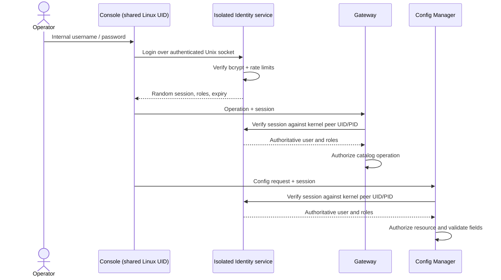

# Internal Console authentication

Console operators have SafeTerm usernames and passwords, independent of Linux
accounts and SSH users. One shared, unprivileged Linux account, `safeterm`, starts
the fixed `/usr/local/bin/safeterm-console` login shell. That shell requires an
internal login before showing the restricted terminal. It never opens Bash.
There is no per-person `useradd`, and the installer does not modify Linux PAM.

## Request path



Gateway routes accepted operations to the existing isolated Runners. Identity
never executes commands or edits application configuration. The existing SSH
Broker keeps its own authentication and `/etc/safeterm/access/ssh/users.json`; creating
an SSH user does not create a Console user, even when their names are equal.

## Provisioning and login

After installing or updating the complete package:

```sh
sudo termctl service status identity
sudo termctl user add console --id alice --roles viewer,netops,config-viewer
# New password: (hidden)
# Confirm password: (hidden)
sudo -iu safeterm
# Username: alice
# Password: (hidden)
# safeterm::alice>
```

No Linux account named `alice` is required. The entry account is initially
password-locked; an authorized Linux administrator can use `sudo -iu safeterm`.
If the site permits direct physical Linux login, set the separate shared entry
password with `sudo passwd safeterm`, then log in as `safeterm` and complete the
mandatory internal login. SafeTerm does not enable Linux autologin. Sharing the
entry credential does not share internal identities, roles or audit attribution.

```sh
sudo termctl user list
sudo termctl user auth console --id alice --roles viewer,config-viewer
sudo termctl user password console --id alice
sudo termctl user del console --id alice
```

The last configured identity cannot be deleted with `termctl`. Fresh packages
include disabled `local-admin` as a placeholder; no default internal password
exists. Enable it by setting a password, or create your own user and delete the
placeholder. For unattended provisioning, use `--password-hash-file FILE` with a
bcrypt hash, never a plaintext password argument. Protect that input file.

Interactive password entry enforces 8–72 printable ASCII characters, uppercase,
lowercase, and a number. Bcrypt uses cost 12 when generated by SafeTerm. Existing
hash imports accept the same bounded bcrypt costs as SSH. A hash cannot prove
that its original plaintext satisfied complexity; provisioning must enforce it.
There is no Console public-key login: optional public keys belong to SSH.

User changes take effect without restarting services. Changing roles, password,
disabled state or deleting the user invalidates old sessions at their next
verification. An already-running stream is rechecked every 15 seconds; the
absolute authentication expiry also cancels execution. Already accepted bounded
unary/config transactions finish under their existing operation deadline;
revocation cannot undo a committed edit. Login again after changing credentials.

## Upgrade from OS-user mappings

Upgrade through `sudo termctl update PACKAGE_DIR` using your normal local or
offline signing mode. The package preserves existing Console records and sets
the new credential ownership. Legacy `os_user` fields are migration metadata only;
they never authenticate a user. Entries without an internal bcrypt hash are
disabled rather than silently retaining Linux-UID-based access.

For the typical legacy record with `user_id: safeterm`:

```sh
sudo termctl user password console --id safeterm
sudo -iu safeterm
# Username: safeterm
# Password: the internal password just set
```

For other records, use their existing `user_id`. `--os-user` is obsolete. Setting
the internal password enables that record and removes its legacy OS mapping.
A roles-only update does not enable a disabled record that already has a hash.
The upgrade does not delete existing Linux accounts or change their passwords.
Stop using old per-person Console entry accounts: the new executable accepts
only the shared `safeterm` account. Review/removal of unrelated Linux accounts is
an administrator decision. Keep an ordinary administrator session available
while upgrading; old Console processes lose access to the new authenticated
boundaries. SSH remains available according to its independent configuration.

## Credential and session boundaries

- `/etc/safeterm/access/console/users.json` is root:safeterm-identity mode 0640. Its
  parent directories must be root-owned and not group/world-writable. The
  shared account must never join the `safeterm-identity` group. Identity refuses
  unsafe credential ownership, extended credential ACLs or entry-account group membership at startup; reads reject symbolic/hard links,
  excess size and insecure permissions.
- `safeterm-identity.service` runs as a separate non-root, nologin service user,
  with a read-only filesystem, no capabilities, Unix sockets only, no core dumps
  and finite memory/task limits. Service accounts are infrastructure accounts;
  their count does not grow with the number of Console operators.
- Identity accepts login/logout only from the shared Console UID. Only Gateway
  and the three configured Config Manager UIDs can verify sessions. Every client
  verifies the daemon UID; every server obtains credentials with `SO_PEERCRED`.
- Each login issues a cryptographically random 256-bit token, stored by digest
  in daemon memory, bound to kernel UID/PID and an absolute expiry. Possession of
  the shared UID or a caller-supplied role is insufficient. Gateway and Config
  Managers replace caller roles with the authority's roles. Unary, streaming,
  termination and configuration paths all enforce this boundary. Config proposal
  tokens are also bound to the originating Console session.
- Default lifetime is 30 minutes, configurable from one minute to twelve hours
  via the Identity unit's `--session-ttl` flag. There is no persistent token or
  refresh credential. Logout removes the session; restarting Identity invalidates
  all sessions. Run `sudo termctl service restart all` for coordinated recovery.
- Login allows at most 5 attempts per username per minute and 30 globally per
  minute, four concurrent bcrypt checks, 32 IPC connections and 1,024 sessions.
  Excess requests fail closed. Three failed prompts close that Console process.
  Unknown users and bad passwords receive the same generic rejection.
- Passwords and tokens are absent from terminal output/history and audit records.
  Console disables dumpability and new privileges before reading credentials.
  Identity logs authentication success/failure/logout through the existing Audit
  service; audit failure denies a new login. Execution/config audit remains in
  `/var/lib/safeterm/audit.jsonl`. Root can still inspect credentials and control
  services; protection against a compromised administrator/kernel is outside this
  boundary. Shared-UID processes can cause denial of service, so do not give the
  entry account a general OS shell or allow untrusted programs under that UID.

## Validation

The automated suite covers internal login, hidden credentials/no login history,
legacy denial, incorrect passwords, throttling, audit failure, expiry/logout,
role revocation, forged identities/roles, process-bound replay protection,
privileged verification-only IPC, stream authentication and operation cancellation
at expiry. Existing SSH/public-boundary tests must remain green.

On a disposable installed host, create two Console users with different roles,
open two `sudo -iu safeterm` sessions, and verify `whoami`, `execute ?`, `config ?`
and differing permissions. Enter an incorrect password, then reset one user's
password from the administrator shell: its old session must fail subsequent
requests, while the other session continues. Check that the shared account
cannot read the credential file and that no per-person account was created:

```sh
sudo -u safeterm test ! -r /etc/safeterm/access/console/users.json
getent passwd alice   # no output unless an unrelated account already existed
sudo journalctl -u safeterm-identity --no-pager -n 25
```

For streaming revocation, observe the documented 15-second recheck interval.
Use Ctrl+C to terminate an operation and Ctrl+] to exit the entire restricted
session. Do not publish the credential file or raw session tokens when reporting
problems.
