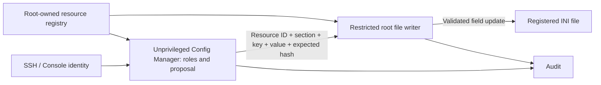

# Manage an external service's INI file without changing its owner

This feature is implemented after v0.20.15. It requires a package containing
ADR-029, including the `safeterm-config-writer` binary and service. Installing
`acl` or changing ACLs alone does not add it to an older Release.

An application file can remain `root:root 0755`, or retain another service's
UID/GID. Do not chown it to a SafeTerm account. The dedicated privileged writer
performs registered field updates and preserves UID, GID, permission bits,
POSIX access ACLs and extended attributes. Users and Config Managers do not get
sudo, root credentials, a general-purpose editor or unrestricted path access.

Register files only through [independent JSON resources](resource-definitions.md)
and `termctl apply`. The former registry workflow is removed (ADR-032).

## Register an external file

Define the exact file path, format, fields and permissions in a JSON file under
`/etc/safeterm/resources.d`. No service block is required. Copy the installed
TEMPLATE.json, remove unused blocks, and see [the complete resource reference](../configs/resources.d/README.md).
Run `sudo termctl check`, then `sudo termctl apply` from a Linux administrator
shell. Do not edit a registry or change the application file's ownership.
The compiler generates the restricted writer's registration and sandbox in the
same signed activation transaction. No ACL change is needed for writer access;
unsafe parent directories and unsupported metadata are refused.

The interactive user enters `config RESOURCE`, `edit SECTION`, `set KEY VALUE`,
`diff`, `save`. See [the terminal guide](restricted-terminal.md).

The writer authenticates the caller using Unix peer credentials and maps each
Config Manager UID to exactly one profile. It independently checks registration,
access mode, editable fields, types/ranges, complete-document rules and expected
versions. It reconstructs the edit itself; callers cannot submit a path, replacement
document, program or arbitrary backup path. The manager remains the trusted
user-role/proposal authority. A compromised manager is bounded to registered field updates and restoration
of writer-created backups in its own profile; this does not claim protection from a malicious
root administrator or malicious administrator-authored schemas.

All parent directories of privileged files must be root-owned, real directories
without group/world write (including ACL write masks). Existing file ownership is
retained. A service-owned writable parent directory cannot satisfy this boundary;
the tool rejects it rather than changing its owner or exposing a symlink race.
Sensitive host paths and broad writable roots such as `/etc` are refused. Targets
must live in dedicated application directories with canonical ASCII paths using
letters, digits, slash, dot, underscore or hyphen. Symlinks, hard links, special
files, set-ID bits, executable capabilities and content-integrity signatures are
refused. Normal ACL/xattr preservation failure aborts before replacement.

INI edits accept and preserve a leading UTF-8 BOM. UTF-16/UTF-32 files are not
supported. Blank lines and consecutive # or ; comments may appear between
sections and fields. INI edits preserve every unrelated byte: comments (including section-header and
inline comments), section/key order, indentation, assignment spacing, quotation
style, LF/CRLF and final-newline state. Only the selected value token is replaced.
Multiline/NUL values, duplicate sections/keys and values that cannot be expressed
with the existing quote style are rejected. Unsupported INI dialects are rejected
before writing; the tool does not rewrite them into a different format. JSON keeps
its existing deterministic renderer and does not offer this INI formatting contract.
JSON nesting is limited to 64 levels to bound parser recursion.

Replacement is atomic and uses a new inode, so inode identity and modification
timestamps naturally change. Metadata is verified before publication. Application
writers must still coordinate with configuration deployment; optimistic version
checks cannot provide an exclusive lock against an unrelated service that ignores
the protocol. Root-private backups are in `/var/lib/safeterm-config-writer`, with
bounded per-resource retention. The writer requires Audit before committing.
SELinux/other security labels are copied only when the host policy permits exact
preservation; the writer never broadens its capabilities to bypass that policy.

The writer runs as root with only `CAP_CHOWN`, `CAP_FOWNER` and
`CAP_DAC_READ_SEARCH` in its capability bounding set, `NoNewPrivileges=yes`, a
read-only system and generated writable application directories. Managers retain
empty capability sets and their original filesystem sandboxes. The writer has no
subprocess or shell execution interface and its socket is accessible only to the
manager service group, with peer-UID checks in addition to socket permissions.
