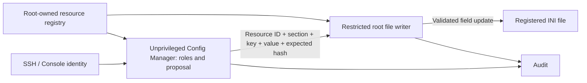

# Manage an external service's INI file without changing its owner

This feature is implemented after v0.20.15. It requires a package containing
ADR-029, including the `safeterm-config-writer` binary and service. Installing
`acl` or changing ACLs alone does not add it to an older Release.

An application file can remain `root:root 0755`, or retain another service's
UID/GID. Do not chown it to a SafeTerm account. The dedicated privileged writer
performs registered field updates and preserves UID, GID, permission bits,
POSIX access ACLs and extended attributes. Users and Config Managers do not get
sudo, root credentials, a general-purpose editor or unrestricted path access.

## Register the file

As the Linux administrator, add a resource to the existing `resources` array in
`/etc/safeterm/config-manager/resources.json`. Do not overwrite other resources.
For a file containing `[Server]` and `Port=8080`, a minimal definition is:

```json
{
  "id": "product-options",
  "description": "External product options",
  "profile": "application",
  "path": "/path/to/option.ini",
  "format": "ini",
  "access": "read-write",
  "privileged_write": true,
  "fields": [
    {
      "section": "Server",
      "key": "Port",
      "type": "integer",
      "required": true,
      "min": 1,
      "max": 65535
    }
  ],
  "backup": { "enabled": true, "keep": 5 },
  "permissions": {
    "read_roles": ["config-viewer", "config-operator"],
    "propose_roles": ["config-operator"],
    "rollback_roles": ["config-operator"]
  }
}
```

Replace the example section/key with actual names in your file. Every editable
field must be explicitly declared. Unregistered keys, comments and sections stay
in the file; they are not exposed as editable fields. Mark sensitive registered
fields with `secret: true`. For hundreds of fields the registry can contain
hundreds of entries; there is no wildcard write permission.

The registry must remain root-owned and not group/world-writable. Then run:

```bash
sudo termctl config check
sudo termctl config apply
```

`check` verifies registry structure, roles/operations, privileged path boundaries,
current document/schema and readable metadata. `apply` generates the writer's
systemd sandbox allowlist and restarts only previously active consumers, including
Gateway and SSH. Run it from an ordinary Linux administration session; active
SafeTerm sessions disconnect. It does not edit application values, change their
ownership, add an ACL or require catalog signing merely for the resource registry.
If activation fails, the previous verified registry and writer sandbox are restored.
An interrupted/unrecovered activation is recovered using
`sudo termctl config rollback`; this command recovers registry activation, not an
application-value backup. Package installation seeds the verified registry.

## Edit through SafeTerm

Log in with a role authorized by the resource and use:

```text
config describe product-options
config show product-options
config edit product-options Server Port
new value: 9090
```

Review the preview and confirm it. A new document version prevents stale proposals
from overwriting an intervening application edit. `config rollback product-options`
inside the restricted shell restores the newest retained application backup.
Application reload/restart is optional and must be configured as a fixed typed
catalog activation operation; do not put shell commands in resource definitions.

## Security and preservation contract



The writer authenticates the caller using Unix peer credentials and maps each
Config Manager UID to exactly one profile. It independently checks registration,
access mode, editable fields, types/ranges, complete-document rules and expected
versions. It reconstructs the edit itself; callers cannot submit a path, replacement
document, program or arbitrary backup path. The manager remains the trusted
user-role/proposal authority. A compromised manager is bounded to registered
editable fields in its own profile; this does not claim protection from a malicious
root administrator or malicious administrator-authored schemas.

All parent directories of privileged files must be root-owned, real directories
without group/world write (including ACL write masks). Existing file ownership is
retained. A service-owned writable parent directory cannot satisfy this boundary;
the tool rejects it rather than changing its owner or exposing a symlink race.
Sensitive host paths and broad writable roots such as `/etc` are refused. Targets
must live in dedicated application directories with canonical ASCII paths using
letters, digits, slash, dot, underscore or hyphen. Symlinks, hard links, special
files, set-ID bits, executable capabilities and content-integrity signatures are
refused. Normal ACL/xattr preservation failure aborts before replacement.

INI edits preserve every unrelated byte: comments (including section-header and
inline comments), section/key order, indentation, assignment spacing, quotation
style, LF/CRLF and final-newline state. Only the selected value token is replaced.
Multiline/NUL values, duplicate sections/keys and values that cannot be expressed
with the existing quote style are rejected. Unsupported INI dialects are rejected
before writing; the tool does not rewrite them into a different format. JSON keeps
its existing deterministic renderer and does not offer this INI formatting contract.

Replacement is atomic and uses a new inode, so inode identity and modification
timestamps naturally change. Metadata is verified before publication. Application
writers must still coordinate with configuration deployment; optimistic version
checks cannot provide an exclusive lock against an unrelated service that ignores
the protocol. Root-private backups are in `/var/lib/safeterm-config-writer`, with
bounded per-resource retention. The writer requires Audit before committing.
SELinux/other security labels are copied only when the host policy permits exact
preservation; the writer never broadens its capabilities to bypass that policy.

The writer runs as root with only `CAP_CHOWN`, `CAP_FOWNER` and
`CAP_DAC_READ_SEARCH` in its capability bounding set, `NoNewPrivileges=yes`, a
read-only system and generated writable application directories. Managers retain
empty capability sets and their original filesystem sandboxes. The writer has no
subprocess or shell execution interface and its socket is accessible only to the
manager service group, with peer-UID checks in addition to socket permissions.
